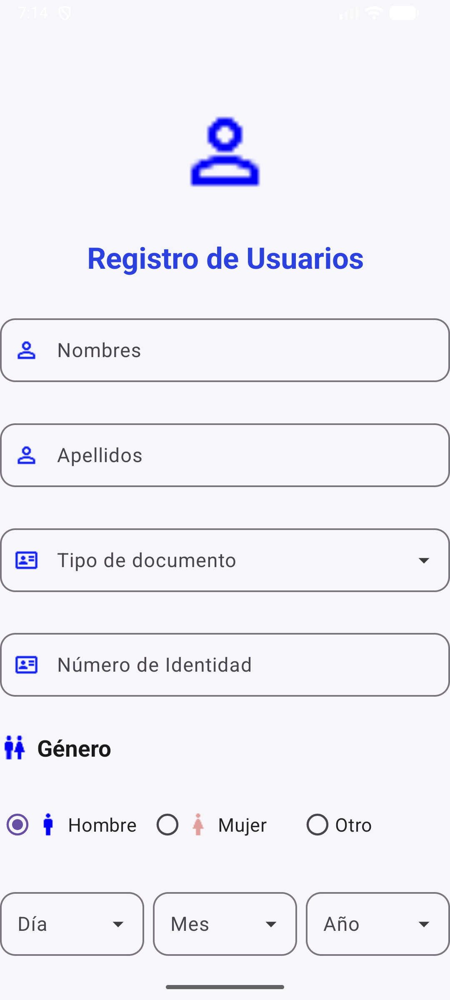

# Práctica 2 — Registro de Usuarios

Aplicación Android desarrollada en **Android Studio** (Java) que implementa un formulario
de registro de usuarios siguiendo los lineamientos de Material Design 3.



---

## ✨ Características

| Elemento | Implementación |
|---|---|
| **Campos de texto** | `TextInputLayout` (OutlinedBox) con ícono inicial y esquinas redondeadas de 14dp |
| **Nombres / Apellidos** | `TextInputEditText` con entrada de tipo texto |
| **Tipo de documento** | Desplegable con 6 opciones (Cédula, Tarjeta de identidad, Pasaporte, etc.) |
| **Número de Identidad** | `TextInputEditText` con entrada numérica |
| **Género** | `RadioGroup` **horizontal** con 3 opciones: Hombre, Mujer, Otro |
| **Fecha de nacimiento** | 3 desplegables: **Día** (1–31), **Mes** (Enero–Diciembre), **Año** (2026–1950) |
| **Layout raíz** | `ConstraintLayout` con **cadena vertical en cascada**: cada elemento está anclado al anterior y al siguiente (`top → bottom` / `bottom → top`), de modo que al mover uno se mueven todos |
| **Título** | Anclado al elemento superior con `16dp` de separación y pegado a la izquierda y a la derecha (`start`/`end` → `parent`) |

Los desplegables muestran la información real seleccionada dentro del campo; el *hint*
sube flotando cuando el campo recibe foco o contiene un valor.

---

## 📁 Estructura del proyecto

```
TAREA/
├── app/src/main/java/com/example/tarea/
│   └── MainActivity.java          # Pobla los desplegables y lee el formulario
├── app/src/main/res/
│   ├── layout/activity_main.xml   # Interfaz completa (ConstraintLayout en cascada)
│   ├── drawable/
│   │   ├── persona.png            # Ícono de avatar / nombres / apellidos
│   │   ├── idcard.png             # Ícono de documento
│   │   ├── generos.png            # Ícono de la sección Género
│   │   ├── hombre.png  mujer.png  # Íconos de las opciones de género
│   │   ├── bg_campo.xml           # Recuadro con borde gris
│   │   ├── bg_campo_foco.xml      # Recuadro con borde azul
│   │   └── ic_flecha_abajo.xml    # Flecha de los desplegables
│   ├── values/strings.xml         # Textos y listas de opciones
│   └── values/colors.xml          # Paleta de colores
└── gradle/                        # Configuración de Gradle
```

---

## 🛠️ Tecnologías

- **Lenguaje:** Java 11
- **SDK:** minSdk / targetSdk 37
- **Librerías:**
  - `com.google.android.material:material` 1.10.0
  - `androidx.constraintlayout` 2.1.4
  - `androidx.appcompat` 1.6.1

---

## ▶️ Cómo ejecutarla

1. Abrir el proyecto en **Android Studio**.
2. **Build → Make Project** (o `Ctrl + F9`).
3. Seleccionar un emulador o un dispositivo con depuración USB.
4. **Run ▶** (o `Shift + F10`).

Por consola de comandos:

```bash
gradlew assembleDebug
```

---

## 📖 Funciones disponibles en `MainActivity.java`

```java
resumenFormulario()   // Devuelve un String con todos los datos capturados
valorDe(campo)        // Devuelve el valor elegido en un desplegable
generoSeleccionado()  // Devuelve "Hombre", "Mujer", "Otro" o ""
```

---

## ✅ Estado

Compila sin errores (`BUILD SUCCESSFUL`).
